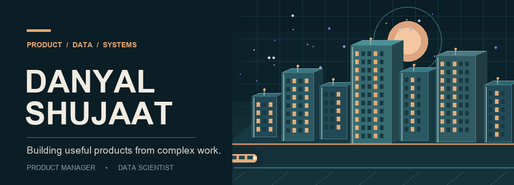

  

# Hi, I’m Danyal 👋

**Product Manager · Data Scientist · SaaS Builder**

I turn complicated workflows into products people can understand and use. My work spans product discovery, experience design, full-stack delivery, and data analysis—especially in HR technology and operational software.

### A little about me

- Product manager at **Veevo Tech**, working where business needs, user journeys, and engineering meet.
- **BS in Data Science**; currently completing an **MS in Project Management**.
- Drawn to products that replace scattered processes with clear ownership, connected records, and useful feedback.

## Selected work

| Project | What it is and what I did |
| :--- | :--- |
| **[Talvynza HRMS](https://github.com/DanyalShujaat/talvynza-hrms)** | A connected workspace for the employee lifecycle. I shaped the workflows and built React and FastAPI features for employee records, recruitment, attendance, leave, payroll, tasks, permissions, and audit history. |
| **[Medica](https://github.com/DanyalShujaat/Medica)** | My final-year medical chatbot project. I built its retrieval-augmented answer flow so questions could be answered with relevant context from source material. |
| **[Epilepsy Signal Lab](https://github.com/DanyalShujaat/epilepsy-signal-lab)** | An EEG seizure-classification project. I prepared signal data, trained and evaluated a supervised model, and built a visual demo to explain the workflow. [Try the demo →](https://danyalshujaat.github.io/epilepsy-signal-lab/) |
| **[FIFA 19 Player Atlas](https://github.com/DanyalShujaat/fifa19-player-atlas)** | An exploratory analysis of football player data. I cleaned and explored the dataset with pandas, visualized player attributes, and built an interactive frontend for the findings. [Try the demo →](https://danyalshujaat.github.io/fifa19-player-atlas/) |

## Where I work best

| Discover | Design | Deliver |
| :--- | :--- | :--- |
| User and business problems, requirements, priorities, product direction | Workflows, information architecture, accessible interfaces, useful defaults | React, TypeScript, Python, FastAPI, PostgreSQL, analytics and iteration |

**Also comfortable with:** scikit-learn · pandas · data visualization · RAG workflows · cross-functional delivery

---

### Let’s connect

Have a product idea, data problem, or role to discuss? **[Send me a message through my portfolio](https://danyalportfolio.netlify.app/#contact)** or [email me directly](mailto:danyal5345@gmail.com).
